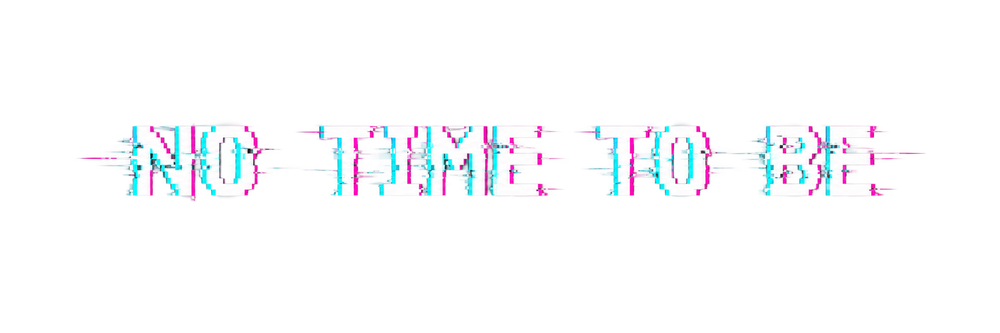

<div align="center">


🏆 **Winner of the Ulli Crespo START-Kunstpreis 2026**
</div>

> *"I wanted to encourage reflection on how often we are so busy fulfilling expectations and working through tasks that we forget to simply live."*

---

No Time to Be is an interactive digital art experience depicting the constant pressure placed on today's teenagers to constantly deliver.

School. Grades. Projects. Career. Family. Social Media. Appearance. Expectations.

You get the idea.

There is always something else to do and somehow, it is never simply to rest.

## Setup

### Prerequisites

- Node.js 18 or newer
- npm

### Install dependencies

```bash
npm install
```

### Run locally

```bash
npm run dev
```

This starts the Vite development server. Open the local URL shown in the terminal in your browser.

### Build for production

```bash
npm run build
```

This creates a production build in the `dist` directory.

### Preview the production build

```bash
npm run preview
```

This serves the built app locally so you can test the final output.
